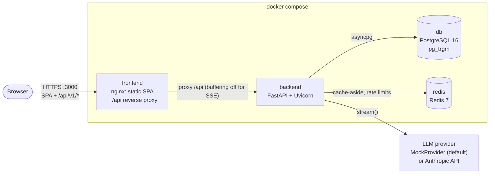
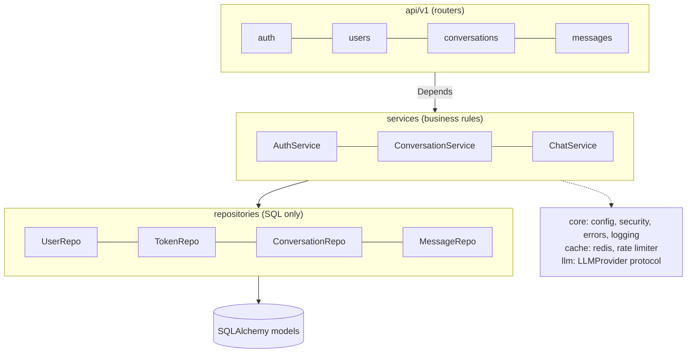
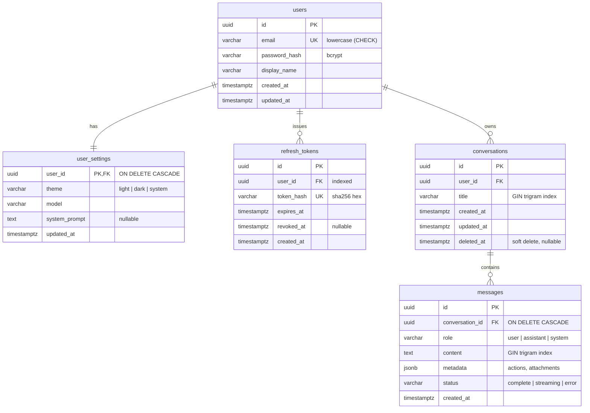
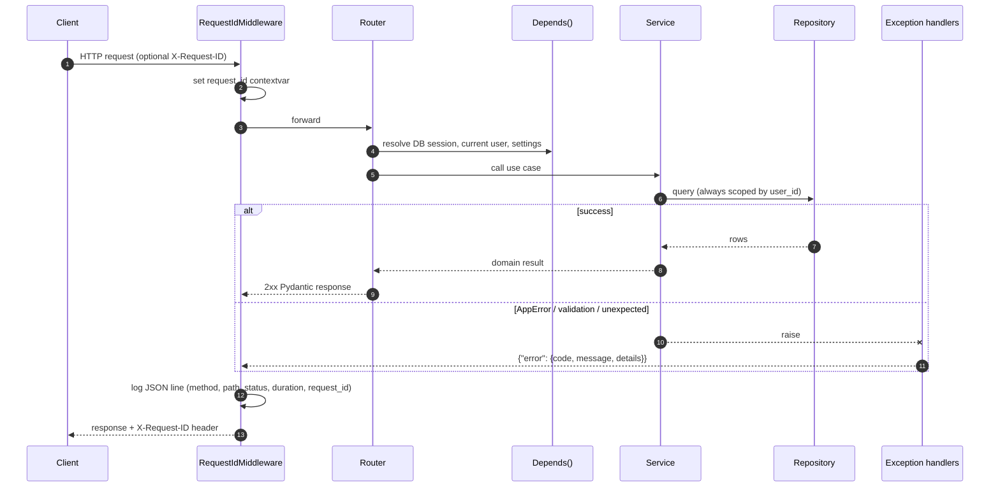
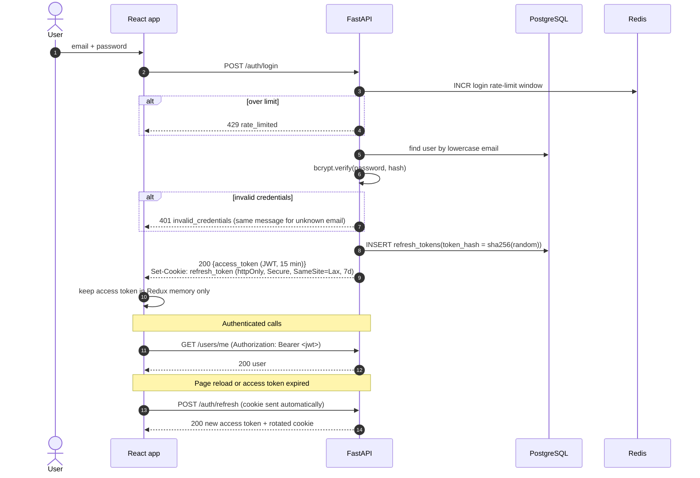
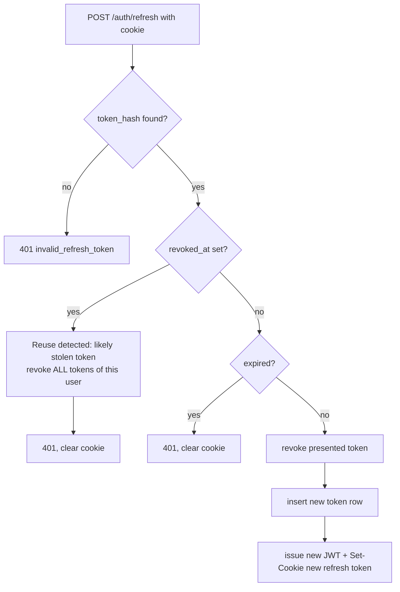
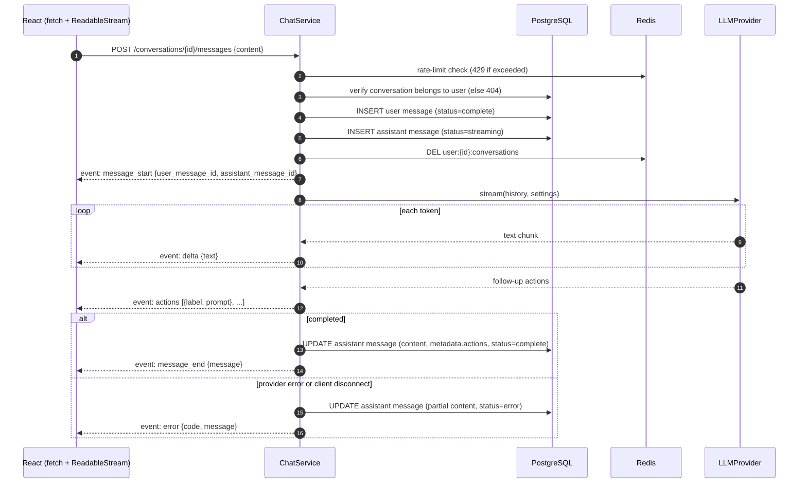
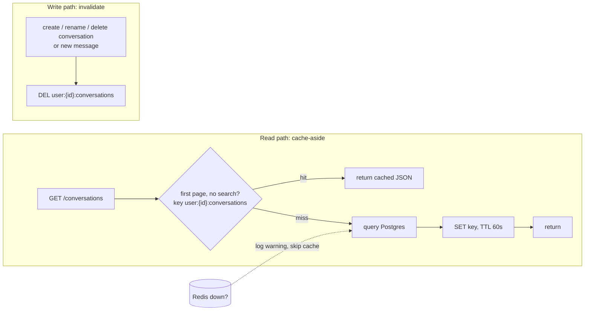
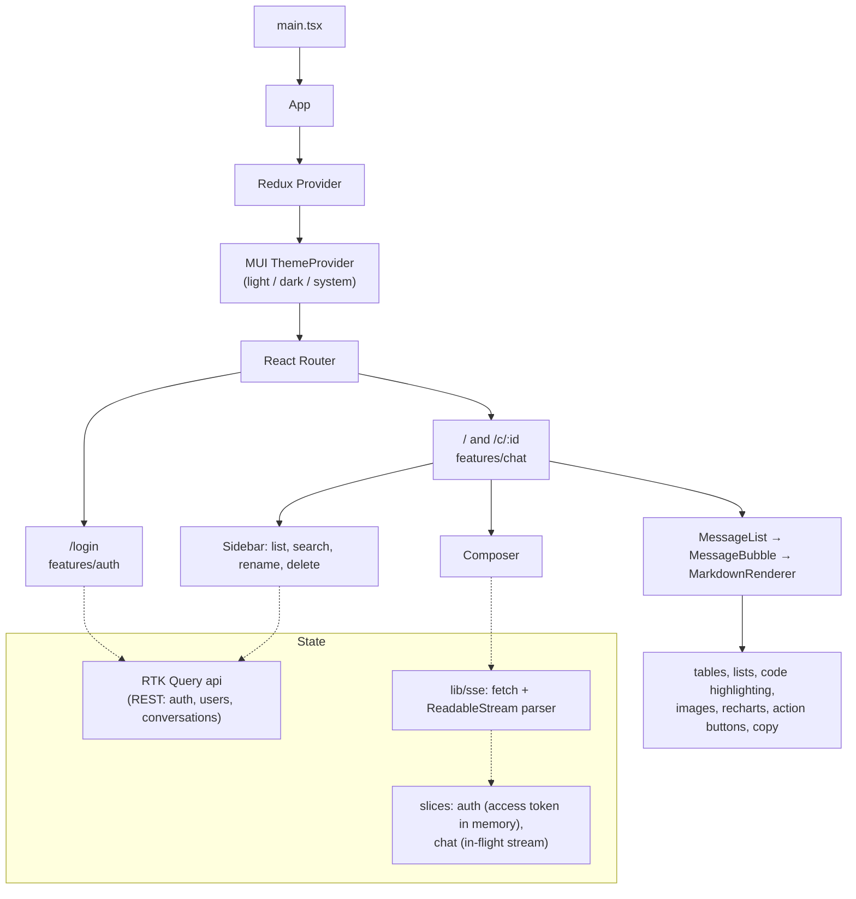

# Diagrams

All diagrams are [Mermaid](https://mermaid.js.org/) and render natively on GitHub.

- [System architecture](#system-architecture)
- [Backend layering](#backend-layering)
- [Entity-relationship diagram](#entity-relationship-diagram)
- [Request lifecycle](#request-lifecycle)
- [Authentication flow](#authentication-flow)
- [Refresh-token rotation and reuse detection](#refresh-token-rotation-and-reuse-detection)
- [Send message + SSE streaming](#send-message--sse-streaming)
- [Conversation list caching](#conversation-list-caching)
- [Frontend structure](#frontend-structure)

---

## System architecture

The browser only ever talks to one origin. nginx serves the built React app and
forwards `/api/*` to the backend, so the refresh-token cookie is first-party and
there is no CORS preflight in the Docker setup.

## Backend layering

Routers parse and validate input, then call one service method. Services hold the
rules: ownership checks, token rotation, when to invalidate the cache. Repositories
only run queries and always take a `user_id` for user-owned data.

## Entity-relationship diagram

**Indexes**

| Index | Purpose |
|---|---|
| `ix_conversations_user_id_updated_at` on `(user_id, updated_at DESC) WHERE deleted_at IS NULL` | Sidebar list and keyset pagination; the partial index skips soft-deleted rows |
| `ix_messages_conversation_id_created_at` | Load a conversation's history in order |
| `ix_conversations_title_trgm`, `ix_messages_content_trgm` (GIN, `gin_trgm_ops`) | `ILIKE '%term%'` search without a sequential scan |
| `uq_refresh_tokens_token_hash` | O(1) lookup of a presented refresh token |
| `ix_refresh_tokens_user_id` | Revoke all of a user's tokens on reuse detection |

## Request lifecycle

## Authentication flow

## Refresh-token rotation and reuse detection

## Send message + SSE streaming

## Conversation list caching

Deleting the key on writes, instead of updating it, means a write can never leave
a stale or half-updated list in the cache.

## Frontend structure

